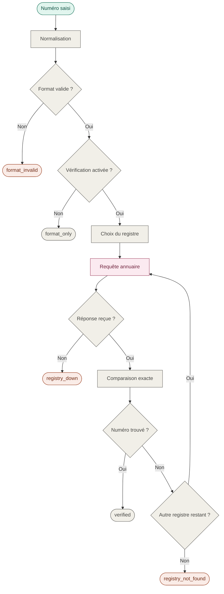

# IFU et RCCM au Bénin : format et vérification d'existence

Recherche du 21 octobre 2026, préalable à la conception du package Composer de validation des identifiants d'entreprise béninois (`egbavou/benin-business-id` ; nom provisoire `benin-ifu-rccm` jusqu'au 21/10/2026).

**Méthode.**
- Trois recherches web menées en parallèle : format de l'IFU, formats du RCCM, sources de vérification d'existence.
- Relecture directe des sources clés :
  - les décrets 2006-201 et 2017-215 ;
  - le guide DGI de 2020 ;
  - la nomenclature RCCM de l'OHADA ;
  - la page « Formalités » du Tribunal de commerce de Cotonou ;
  - le swagger e-MECeF ;
  - les fiches GLEIF ;
  - deux sites d'entreprise.
- Inspection en lecture seule des portails DGI et APIEx, y compris de leur code JavaScript public.
- Sur l'annuaire public de l'APIEx :
  - 17 requêtes GET, une par une, portant sur des numéros RCCM de sociétés déjà publiés ailleurs ;
  - un relevé statistique d'environ 450 requêtes de comptage (§2.7), à une requête par seconde au plus.
- Aucun formulaire n'a été soumis et aucun CAPTCHA n'a été contourné.

**Confiance.**
- **[H]** haute : source primaire, ou plusieurs sources concordantes.
- **[M]** moyenne : source secondaire fiable, ou déduction tirée de nombreuses données.
- **[B]** basse : source unique, ou simple déduction.

La mention « relu » signale une source que j'ai lue moi-même pendant la vérification.

---

## 0. Synthèse

| | IFU | RCCM |
|---|---|---|
| **Forme** | 13 chiffres [H] | `RB/<greffe>/<année> <lettre> <numéro>`, par exemple `RB/COT/18 B 22272` [H] |
| **Structure** | type de contribuable (1 chiffre), année d'immatriculation à l'IFU (4), séquence, chiffre clé [H/M] | `RB` (Bénin), code de greffe en 3 lettres, année sur 2 chiffres (4 sur d'anciens numéros), lettre de catégorie, numéro d'ordre de 1 à 6 chiffres [H] |
| **Clé de contrôle** | elle existe (« chiffre clé », décret 2006-201) mais son algorithme n'est publié nulle part. Aucun algorithme connu ne colle aux 390 numéros réels testés. Il ne faut donc pas la vérifier [H]. | aucune [H] |
| **Source d'existence** | **aucune utilisable** : la recherche DGI est protégée par un reCAPTCHA et l'API e-MECeF n'a pas de recherche [H] | **annuaire public de l'APIEx** (monentreprise.bj) : API JSON sans authentification, couvrant sociétés et établissements ; numéros de 2002 à 2026 trouvés [H]. Ni API documentée, ni conditions d'utilisation [H]. |

**Retenu avec l'utilisateur (21/10/2026) :**
- IFU : la règle de format déclarée par l'État (13 chiffres, statut de 0 à 6, année de 2006 à l'année en cours), sans source d'existence. Un IFU valide finit en `format_only`.
- RCCM : une règle de format stricte tirée du registre officiel (greffes et lettres en liste fermée). La vérification dans l'annuaire APIEx est désactivée par défaut, et `registry_down` est renvoyé si l'annuaire est indisponible.

Le détail des décisions est au §6.

---

## 1. IFU, Identifiant Fiscal Unique

### 1.1 Textes et sources officielles

| Texte | Ce qu'il dit du format | Source | Confiance |
|---|---|---|---|
| Décret n° 2006-201 du 08/05/2006, art. 5 | « composé de treize (13) chiffres dont le dernier est le chiffre clé ». Les établissements secondaires reçoivent l'IFU de la maison mère, l'avant-dernier chiffre étant modifié. Le même article affirme pourtant que le numéro ne contient « aucun code caractéristique », ce que la pratique dément (§1.3). | https://sgg.gouv.bj/doc/decret-2006-201/download (relu) | H |
| Décret n° 2015-268 du 22/05/2015, art. 6 | Reprend les 13 chiffres, le chiffre clé et la règle de l'avant-dernier chiffre. | https://sgg.gouv.bj/doc/decret-2015-268/download (scan lu pendant la recherche, non relu) | H |
| **Décret n° 2017-215 du 10/04/2017 (en vigueur)** | IFU personnel (art. 3) ; répertoire national des contribuables (art. 5 et 6) ; sanction de l'usage frauduleux d'un IFU (art. 10) ; **abroge le décret 2006-201** (art. 11). **Ne dit rien du format.** | https://sgg.gouv.bj/doc/decret-2017-215/download (scan relu) | H |
| Guide DGI « Tout savoir sur l'IFU au Bénin », DIRCOM/PR, octobre 2020 | « IFU = numéro à 13 chiffres » (p. 5). Donne le premier chiffre selon le type de contribuable (§1.3). | https://www.gouv.bj/doc/158/download (relu) | H |
| Document DGI « Tout sur l'identifiant fiscal unique », février 2014 (mis en ligne en 2016) | « entièrement numérique et composé de 13 caractères ». Il découpe le numéro en 5 segments : statut (1 à 6), année d'immatriculation (4), séquence (6), ordre (1), clé de contrôle (1), cette dernière « créé[e] par un algorithme », sans plus de détail. | https://impots.finances.gouv.bj/wp-content/uploads/2016/12/IFU.pdf, serveur injoignable le 21/10/2026 ; copie archivée relue : https://web.archive.org/web/20190214115719/http://www.impots.finances.gouv.bj:80/wp-content/uploads/2016/12/IFU.pdf | H |
| Code général des impôts 2022 (loi n° 2021-15 du 23/12/2021), art. 460 à 462 et 495 | Obligation de s'immatriculer, mention de l'IFU sur les documents, opérations qui l'exigent, sanctions en cas d'IFU absent ou faux. **Rien sur le format.** | https://sgg.gouv.bj/doc/loi-2021-15/download (relu, texte issu d'une reconnaissance de caractères) | H |
| **Code général des impôts 2026 consolidé** (loi n° 2021-15 mise à jour de la loi de finances 2026, loi n° 2025-22 du 08/12/2025), art. 460 à 462 modifiés par les lois de finances 2023 et 2024 | Immatriculation, opérations exigeant l'IFU, registre des bénéficiaires effectifs. **Rien sur le format** : aucune occurrence de « treize », « 13 chiffres » ou « chiffre clé ». | DGI, PDF « Code Général des Impôts 2026 » (créé le 23/01/2026), lu via une copie archivée le 22/10/2026 (§7) | H |
| Portail DGI `ifu.impots.bj` (code public de l'application) | Le seul contrôle appliqué à un IFU saisi est sa longueur : 13 caractères, avec le message « Ce champs est obligatoire et doit contenir 13 chiffres ! ». | https://ifu.impots.bj (relu, 21/10/2026) | H |
| org-id.guide, liste `BJ-IFU` | Même découpage 1 + 4 + 6 + 1 + 1, exemple `3200901353510`. Le dernier chiffre est décrit comme un « checksum », sans algorithme. Le guide note qu'aucune source en ligne du registre n'a été trouvée. | https://org-id.guide/list/BJ-IFU (relu) | M |
| API e-MCF (facturation électronique DGI) | Swagger officiel : champ `ifu` de type `string`, sans motif. La spécification v1.0 du 15/01/2021 indique 13 caractères et donne les valeurs de test `9999900000001` et `9999900000002`. | https://developper.impots.bj/sygmef-emcf/swagger/v1/swagger.json (relu) ; spécification v1.0 trouvée seulement dans un dépôt tiers : https://raw.githubusercontent.com/codianselme/lara-sygmef/master/docs/e-MECeF_API_v1.0.pdf | H (swagger), M (spécification) |

### 1.2 Longueur, caractères, écritures

- **13 chiffres, sans lettre** [H]. Tous les exemples réels trouvés le confirment.
- **Écritures observées**, à normaliser :
  - espaces : `1 2016 4407 3302` (spécimen d'attestation du guide 2020) ;
  - points : `3.201.200.247.219` (31 des 359 occurrences de la liste CCIB 2015) ;
  - coupure arbitraire : `32009008191 13` (MTN, document vu seulement dans l'index du moteur de recherche) ;
  - préfixe `BJ-IFU-` (identifiants org-id et IATI) ;
  - libellés « IFU : », « IFU N° ».
- **Coquilles à 14 chiffres** fréquentes, même dans des documents officiels. Exemples : `99999000000001` dans les exemples JSON de la spécification e-MCF, `32000700033415` pour la SONEB dans les données IATI. Un contrôle de longueur strict est donc utile [H].
- **Validation des SDK e-MECeF existants** : `codianselme/lara-sygmef` applique `^[0-9]{13}$` ; `tigamadou/emecef-core-php` ne valide rien [H]. Source : https://github.com/codianselme/lara-sygmef

### 1.3 Structure

| Positions | Contenu | Confiance |
|---|---|---|
| 1 | Type de contribuable (tableau suivant) | H |
| 2 à 5 | **Année d'immatriculation à l'IFU**. Ce n'est ni l'année de création de l'entreprise, ni l'année de naissance. Exemple : une société inscrite au RCCM en 1983 a un IFU de 2007 (liste CCIB 2015). | H |
| 6 à 11 | Séquence dans l'année (document DGI 2014) | H |
| 12 | « Ordre » : 1 pour l'entreprise mère, 2 à 9 pour une filiale ou agence, 0 pour les autres contribuables. Règle vérifiée sur les numéros de 2007 à 2016 : 299 sociétés sur 300 ont un 1, 52 personnes physiques sur 52 ont un 0. **Elle n'est plus respectée depuis 2017 environ** : la société mère SBIN a un 2, d'autres sociétés un 5, un 0 ou un 3. | H avant 2017, M après |
| 13 | Chiffre clé, algorithme inconnu (§1.4) | H pour son existence |

**Premier chiffre, type de contribuable :**

| Valeur | Sens | Source | Confiance |
|---|---|---|---|
| 0 | Personne physique ou entreprise individuelle. Absent du document de 2014 ; le guide 2020 l'ajoute sans le définir ; un seul exemple trouvé. | Guide 2020, p. 10 (relu) | M |
| 1 | Personne physique, homme | Document DGI 2014 ; guide 2020, p. 10 | H |
| 2 | Personne physique, femme | Idem | H |
| 3 | Société : « commence par le chiffre '3' suivi de l'année d'immatriculation » | Guide 2020, p. 11 (relu) | H |
| 4 | Structure étatique | Guide 2020, p. 14 (relu) | H |
| 5 | Organisation internationale ou mission diplomatique | Document DGI 2014 (relu) ; absent du guide 2020 | H |
| 6 | ONG ou association : « commence toujours par le chiffre '6' » | Guide 2020, p. 13 (relu) | H |
| 7, 8, 9 | Jamais observés. Le 9 n'apparaît que dans les valeurs de test e-MECeF. | — | M |

**Une entreprise individuelle n'a pas d'IFU propre** : elle utilise celui de son promoteur, qui commence par 1, 2 ou 0 (guide 2020, p. 10, relu) [H]. Vérifier l'IFU d'une entreprise individuelle revient donc à traiter l'identifiant fiscal d'une personne.

**Écarts à ne pas transformer en règle stricte :**
- Des communes déclarent sur IATI un IFU commençant par 6 ou 5 alors qu'on attendrait un 4 : Parakou `6201000068802`, Adjohoun `5200801335602`. La DGI ne classe donc peut-être pas toutes les collectivités de la même façon, à moins que les données IATI soient fausses [B]. Source : https://analytics.codeforiati.org/reporting_orgs.html
- La liste CCIB 2015 contient une entreprise individuelle (registre A) dont l'IFU commence par 3 : `3201100364817` [M].
- La même liste contient **6 numéros sur 358** qui ne suivent pas le schéma type + année, par exemple `2977421186134` et `2543420000243`. Il peut s'agir de numéros de première génération, d'anciens identifiants ou de fautes de saisie [B]. Source : https://s3-eu-west-1.amazonaws.com/s3.sourceafrica.net/documents/26559/LISTE-ENTREPRISES-CCIB-2015.pdf
- Années observées : **2007 à 2026**. Aucune de 2006, alors que le décret date de 2006 [M]. Une commune déclare l'année « 2000 » (`5200081145006`, Toffo), probablement une coquille [B].
- Le portail IFU affichait le 21/10/2026 : 1 808 911 particuliers, 504 366 personnes morales et 3 126 « entités » immatriculées (https://ifu.impots.bj/accueil, relu).

### 1.4 Chiffre clé : aucun algorithme connu

- **Il existe** (décrets 2006-201 et 2015-268), mais **aucune source n'en donne l'algorithme** : ni les décrets, ni le guide 2020, ni le document de 2014, ni la spécification e-MCF, ni org-id.guide, ni les SDK [H].
- **Tests sur 390 IFU réels** : 352 de la liste CCIB 2015 et 38 d'autres sources. Les algorithmes Luhn, EAN-13, Verhoeff et Damm, mod 11 avec plusieurs pondérations, mod 97, ISO 7064 MOD 11-10 et MOD 11-2 ne concordent que dans 7 à 15 % des cas. C'est le niveau du hasard (10 %) [H].
- **Test algébrique général** : aucune somme pondérée linéaire, mod 10 ou mod 11, ne reproduit la clé sur l'ensemble des données, ni sur 3 000 sous-échantillons aléatoires de 20 numéros. Ce test tolère donc quelques coquilles dans les données [H].
- **Indice supplémentaire** : l'exemple DGI `3200800000314` (mère), `…324` et `…334` (filiales) garde la même clé alors que le 12e chiffre change [M].
- **Conséquence** : ne pas vérifier la clé. Un mauvais algorithme rejetterait environ 90 % des IFU réels.

Les scripts de test et la liste de 358 IFU n'ont pas été copiés dans ce dépôt, car la liste contient des IFU de personnes physiques. Ils restent dans le répertoire temporaire de la session de recherche.

### 1.5 Repères historiques

| Date | Événement | Source | Confiance |
|---|---|---|---|
| 08/05/2006 | Décret 2006-201 : création de l'IFU, 13 chiffres dont un chiffre clé | sgg.gouv.bj (relu) | H |
| 2007 | Premières années visibles dans les numéros ; des sociétés anciennes reçoivent un IFU daté de 2007 | liste CCIB 2015 | M |
| 22/05/2015 | Décret 2015-268 : reprend le format | sgg.gouv.bj | H |
| 10/04/2017 | Décret 2017-215 : abroge le décret 2006-201 et ne décrit plus le format | sgg.gouv.bj (relu) | H |
| depuis 2017 environ | Le 12e chiffre ne suit plus la règle mère / filiale ; les positions 6 à 12 se comportent comme une séquence de 7 chiffres | 12 exemples réels | B |
| octobre 2020 | Guide DGI : 13 chiffres et premiers chiffres 0/1/2, 3, 4, 6 | gouv.bj/doc/158 (relu) | H |
| 08/12/2021 | IFU obtenu en ligne grâce au **NPI** (Numéro Personnel d'Identification de l'ANIP) | https://www.gouv.bj/article/1600/dgi-obtenez-desormais-votre-moins-24h-avec-votre-numero-personnel-identification-/ | H |
| avril 2022 | Nouvelle **attestation** IFU avec QR code, délivrée sur e-services.impots.bj. C'est le document qui change, pas le numéro. | presse : https://triomphemag.com/benin-nouveau-format-de-delivrance-en-ligne-de-lidentifiant-fiscal-unique-ifu/ | M |

**Aucun texte trouvé ne change la longueur ou la structure du numéro entre 2015 et 2026** [M]. Les articles du Code général des impôts consacrés à l'IFU (art. 460 à 462) ont été lus dans le CGI 2022 puis dans le CGI 2026 consolidé : ils ne fixent aucun format (§7).

**Le NPI n'est pas un IFU.** C'est un identifiant de personne physique délivré par l'ANIP. Le portail DGI accepte « IFU ou NPI » dans sa recherche, mais le NPI sort du périmètre du package.

### 1.6 La règle que déclare l'État béninois

L'utilisateur a demandé, le 21/10/2026, d'appliquer la règle déclarée par l'État. Ce qu'en disent les sources officielles, une à une :

| Élément | Ce qui est déclaré | Par qui |
|---|---|---|
| Longueur, caractères | 13 chiffres | décrets 2006-201 et 2015-268 ; document DGI 2014 ; guide 2020 ; contrôle du portail DGI |
| 1er chiffre | 1 à 6 selon le statut (2014) ; 0, 1 ou 2 pour une personne physique ou une entreprise individuelle (2020) | document DGI 2014 ; guide 2020 |
| Chiffres 2 à 5 | année d'immatriculation à l'IFU | document DGI 2014 ; guide 2020 |
| Chiffres 6 à 11 | séquence dans l'année | document DGI 2014 |
| Chiffre 12 | ordre : 0, 1 ou 2 à 9, donc tout chiffre est admis | document DGI 2014 |
| Chiffre 13 | clé de contrôle « créée par un algorithme » non publié | décrets ; document DGI 2014 |
| Textes en vigueur | le décret 2017-215 et le CGI 2026 consolidé ne disent rien du format | relus (22/10/2026) |

**Règle déclarée, traduisible en code :**
- 13 chiffres ;
- premier chiffre dans {0, 1, 2, 3, 4, 5, 6} ;
- chiffres 2 à 5 formant une année d'immatriculation plausible. La borne basse naturelle est 2006, année du décret qui crée l'IFU. La borne haute est l'année en cours.

**Ce qui ne peut pas être appliqué :**
- **La clé de contrôle.** Elle est déclarée, mais son algorithme n'est pas publié, et aucun algorithme connu ne colle aux numéros réels (§1.4).
- **Le chiffre d'ordre.** Il ne contraint rien, puisque tout chiffre de 0 à 9 a un sens déclaré.

**Effet sur les numéros réels.** Cette règle rejette les numéros qui s'écartent de ce que l'État déclare :
- 6 numéros sur 358 de la liste CCIB 2015, sans année lisible (`2977421186134`, `2543420000243`…) ;
- l'IFU déclaré par la commune de Toffo sur IATI, qui porte l'année 2000 (`5200081145006`).

Ces numéros sont publics mais non conformes à la règle déclarée. Ils sont soit hérités, soit mal saisis.

---

## 2. RCCM, Registre du Commerce et du Crédit Mobilier

### 2.1 Cadre

- **L'Acte uniforme OHADA relatif au droit commercial général** (15/12/2010) impose un numéro d'immatriculation personnel et unique, sans en fixer la structure [H]. Source : https://faolex.fao.org/docs/pdf/oha195620.pdf
- **Le Tribunal de commerce de Cotonou (TCC)** décrit le numéro en 5 « sigles » (relu, https://tcc.justice.bj/rccm/formalites) [H] :
  1. 2 lettres pour l'État partie ;
  2. 3 lettres pour la ville, siège de la juridiction compétente ;
  3. l'année de réception de la formalité ;
  4. une « lettre-clé qui détermine le type d'assujetti ou de formalité » ;
  5. des chiffres donnant le rang de la formalité.

  La page ajoute que le numéro analytique « a été abandonné au profit du numéro chronologique annuel ».
- **Le TCC fonctionne depuis fin 2017.** Le serveur RCCM du tribunal de première instance de Cotonou lui a été transféré le 30/10/2019 [H]. Source : https://tcc.justice.bj/documents/actes-internes/LE%20TCC%20ET%20SON%20FONCTIONNEMENT.pdf
- **La loi 2016-15** prévoit trois tribunaux de commerce : Cotonou, Abomey et Parakou. Seul celui de Cotonou apparaît sur les portails judiciaires [H/M]. Source : https://sgg.gouv.bj/doc/loi-2016-15/download

### 2.2 Format en usage de 2007 à 2026

Exemple : `RB/COT/18 B 22272`.

| Segment | Exemple | Règle | Confiance |
|---|---|---|---|
| Pays | `RB` | « République du Bénin ». Ce n'est **pas** le code ISO `BJ`. | H |
| Greffe | `COT` | 3 lettres (§2.3) | H |
| Année | `18` | 2 chiffres. **4 chiffres sur d'anciens numéros, conservés tels quels dans le registre officiel** : l'annuaire APIEx stocke `RB/COT/2005 B 0040`. | H |
| Lettre | `B` | Catégorie (§2.4) | H |
| Numéro d'ordre | `22272` | De 1 à 6 chiffres, parfois avec des zéros en tête (`0040`). Un seul chiffre est possible : `RB/ABY/24 A 3` figure dans l'annuaire APIEx. | H |
| Séparateurs | `/`, `/`, espace, espace | Forme stockée par l'APIEx : `RB/XXX/AA L N` | H |

**Numéro d'ordre et année.**
- Le TCC parle d'un compteur « annuel ». Pourtant, les numéros Cotonou / B croissent d'une année sur l'autre : 369 en 2007, 22272 en 2018, 39072 en 2024, 42704 en 2026.
- À l'inverse, l'annuaire APIEx contient pour Abomey / A en 2024 à la fois `33587` et `3`.
- **Aucune règle ne relie le numéro à l'année. Il ne faut pas en valider la cohérence** [M].

**Renumérotations.**
- L'annuaire APIEx garde la trace d'anciens numéros, par exemple `RB/COT/07 B 2058 (Ancien n°: 02 B 1545)` pour la Société Générale Bénin, ou `RB/COT/07 B 934 (Ancien n° 15 053 - B)` pour la BOA-Bénin. Le stock de sociétés de Cotonou a donc été renuméroté en 2007 [H, constaté le 21/10/2026].
- D'autres renumérotations ont eu lieu plus tard : `RB/COT/15 B 13611 (Ancien no: 2006 B 0040)` [H].
- **Une même société peut donc avoir deux numéros en circulation.** La Société Générale Bénin affiche encore `RB COTONOU 2005 M 2323` sur son site (https://societegenerale.bj/fr/mentions-legales/), alors que GLEIF et l'APIEx donnent `RB/COT/07 B 2058` [H].

### 2.3 Codes de greffe

| Code | Ville | Preuve | Confiance |
|---|---|---|---|
| COT | Cotonou | Nombreux exemples, GLEIF et APIEx (relus) | H |
| ABC | Abomey-Calavi | `RB/ABC/26 B 11379` (site de la société et APIEx, relus) ; `RB/ABC/23 B 7460` sur un extrait du TCC | H |
| PNO | Porto-Novo | `RB/PNO/21 B 3560` (rapport BOAD et APIEx, relus) | H |
| PKO | Parakou | `RB/PKO/23 A 18689` (site de l'établissement et APIEx, relus) | H |
| ABY | Abomey | `RB/ABY/21 B 642` (Ayido) ; `RB/ABY/24 A 33587` (APIEx, relu) | H |
| LKS | Lokossa | `RB/LKS/23 B 876` (Ayido et APIEx, relus) | H |
| NAT | Natitingou | `RB/NAT/25 B 924` (Ayido) | M |
| DGO | Djougou | `RB/DGO/21 B 402` (Ayido) | M |
| KDI | Kandi | `RB/KDI/22 B 132` (Ayido) ; `RB KDI 22 B 137` (liste Orabank) | M |
| SVL | Savalou | `RB/SVL/22 B 234` (Ayido) | M |
| APL | Aplahoué | `RB/APL/26 B 157` (Ayido, un seul exemple) | M |
| PN, PK, ODH, POB, ALD | Codes anciens, plus attribués depuis 2021 | Registre officiel APIEx (§2.7) | H |
| LOK, SAV, PRK, CTN… | Variantes vues seulement dans les listes CCIB 2011 à 2015, absentes du registre officiel | Listes CCIB, saisies à la main | B |

« Ayido » désigne l'annuaire ayido.africa, qui dit reprendre les données de l'APIEx. C'est une source secondaire.

- **Aucune table officielle des codes n'a été trouvée** [H].
- Les codes supposés au départ LOK, DJO, KAN et SAV sont **faux** pour les numéros actuels : les codes réels sont LKS, DGO, KDI et SVL [M].
- Le relevé du registre officiel (§2.7) complète cette liste avec cinq codes anciens, qui ne sont plus attribués depuis 2021 : PN (Porto-Novo), PK (Parakou), ODH (Ouidah), POB (Pobè) et ALD (Allada). Aucun code n'existe pour Malanville, Comé, Dassa-Zoumè ou Savè. Les entreprises de Ouidah reçoivent aujourd'hui un code ABC, et une pharmacie de Kétou a un code PNO.
- Le code désigne **le registre local**, pas le tribunal qui délivre le numéro : le TCC délivre des numéros COT, ABC et PNO.
- Ces codes **ne sont pas des codes IATA** : Cotonou est COO en IATA mais COT au RCCM [M].

### 2.4 Lettres de catégorie

**Nomenclature RCCM de l'OHADA (juin 2019), relue** : https://e-rccm.ohada.org/pdf/Nomenclature-des-Codes-RCCM-OHADA.pdf

| Lettre | Anciens codes (« utilisés dans le logiciel ») | Nouveaux codes (« validation 2019 ») |
|---|---|---|
| A | Personne physique | Personne physique |
| B | Personne morale | Personne morale |
| C | GIE et autres groupements | Société coopérative |
| D | Dépôts | Dépôts |
| E | Entreprenant | Entreprenant |
| G | Transcription d'office | GIE et autres groupements |
| K | Société coopérative | — |
| M | Modification | Modification |
| R | Radiation | Radiation |
| S | Sûretés | Sûretés |
| T | — | Transcription d'office |

**Lettres observées au Bénin :**
- **A** : établissement d'une personne physique. Registre « A (Établissement) » du TCC ; registre des personnes physiques de l'APIEx [H].
- **B** : société [H].
- **C** : GIE, selon l'ancien code. `RB/PNO/23 C 28` figure dans le registre des **sociétés** de l'APIEx, avec la forme GIE (relu) [H].
- **D** : `RB/COT/23 D 232` figure aussi dans le registre des sociétés de l'APIEx, avec la forme « CIP » (relu). Dans la nomenclature OHADA, D désigne un dépôt d'actes, pas une immatriculation. **Le sens de D au Bénin reste inconnu** [B].
- **M** : numéro de modification, parfois affiché à tort comme numéro d'immatriculation (`RB COTONOU 2005 M 2323`) [M].
- **E, G, K, R, S, T** : aucun exemple béninois [M].

### 2.5 Nomenclature OHADA de 2019 : pas appliquée au Bénin

- **Structure** (relue) : code pays ISO (2 lettres), code ville IATA (3), code juridiction (2 chiffres), année (4), code de formalité (3 caractères, par exemple `B12` pour une SARL pluripersonnelle), numéro (5 chiffres), le tout séparé par des tirets. Exemple du document : `CM-YDE-01-2015-B23-00010`.
- **Son exemple béninois contredit sa propre règle** : `RB-COO-01-2015-E10-00100` utilise `RB` au lieu de `BJ`, et `COO` au lieu de `COT` [H].
- **Aucune preuve d'application au Bénin** [M/H] :
  - la page du TCC décrit toujours 5 segments ;
  - un extrait du TCC de novembre 2023 porte `RB/ABC/23 B 7460` ;
  - l'annuaire APIEx contient des numéros de 2026 au format classique, comme `RB/ABC/26 B 11379` ;
  - les recherches sur « BJ-COT-01 » et « RB-COT-01-202x » ne donnent rien.

### 2.6 Écritures à normaliser

Toutes ces formes ont été vues dans des documents publics. Les sources sont détaillées dans les rapports de recherche et au §4.

| Cas | Exemples |
|---|---|
| Préfixes | `RCCM RB/COT/25 B 41160`, `RCCM : RB/COT/24 B 39072`, `N°RCCM : RB/COT/19 B23728`, `RCCM n° RB/COT/22 B 33303`, `Cotonou N° RCCM RB/ABC/23 B 7460`, `ABOMEY N° RCCM RB/ABY/16 B144` |
| Suffixes | `RB/PKO 18 B 277 du 13/06/2018`, `RB/COT/21 B 30769 du 06/10/2021`, `RB/COT/07 B 2058 (Ancien n°: 02 B 1545)` |
| Séparateurs | `RB/COT/07-B-1432`, `RB/COT/07/B 1351`, `RB/COT/07/A/2360`, `RB/LKS/10-B-131`, `RB KDI 22 B 137` |
| Sans séparateur | `RB/Cot/13B9933`, `RB/COT/19B24028`, `RBCOT24B38169`, `RBABC23B6259`, `RBABC2012A1034` |
| Casse | `RB/Cot/13B9933` |
| Année sur 4 chiffres | `RB/COT/2005 B 0040`, `RB/LKS/2008-B-180`, `RB/ABY/2007/M/44` |
| Ville en toutes lettres | `RB COTONOU 07/A/840`, `RB/PORTO-NOVO/2010-A…`, `RB ABOMEY 2011 - M - 154` |
| Espaces parasites | `RB/COT/08 B33 18` (sic) |
| Anciens numéros locaux, avant 2007 | `24905-B`, `11.389-B`, `02 B 1545`, `15 053 - B` |
| Erreurs de champ | GLEIF enregistre l'IFU `3200700019113` d'Ecobank Bénin à la place du RCCM (relu) |

### 2.7 Relevé du registre officiel (annuaire APIEx, 21/10/2026)

**Pourquoi ce relevé.**
- L'utilisateur veut une règle RCCM stricte, fondée sur la documentation béninoise.
- Or aucun texte béninois ne publie la liste des codes de greffe ni des lettres. La page du TCC (relue) décrit seulement les cinq segments.
- La seule référence exhaustive est donc le registre lui-même, d'où ce relevé statistique sur les deux registres de l'annuaire APIEx.

**Méthode.**
- Uniquement des comptages par sous-chaîne sur le champ « Numéro RC » (filtre `icontains`), avec une requête par seconde au plus.
- Environ 450 requêtes au total.
- Aucun enregistrement n'a été conservé : seul le numéro RC des échantillons a été lu.

**Codes de greffe**, en nombre de numéros contenant `RB/<code>/`. Les comptes incluent quelques occurrences dans les mentions « (Ancien n° …) ».

| Code | Ville | Sociétés | Établissements | Numéros d'année 2021 ou plus ? |
|---|---|---|---|---|
| COT | Cotonou | 34 895 | 109 975 | oui |
| ABC | Abomey-Calavi | 11 986 | 111 172 | oui |
| PNO | Porto-Novo | 6 145 | 76 273 | oui |
| PKO | Parakou | 1 474 | 28 966 | oui |
| ABY | Abomey | 988 | 39 464 | oui |
| LKS | Lokossa | 482 | 11 997 | oui |
| NAT | Natitingou | 215 | 7 737 | oui |
| DGO | Djougou | 216 | 7 038 | oui |
| KDI | Kandi | 110 | 7 115 | oui |
| APL | Aplahoué | 158 | 5 121 | oui |
| SVL | Savalou | 62 | 3 484 | oui |
| PN | Porto-Novo, ancien code | 484 | 1 834 | **non** (2003 à 2014 vus) |
| PK | Parakou, ancien code | 53 | 1 335 | **non** (2013 à 2015 vus) |
| ODH | Ouidah | 66 | 592 | **non** (2002 à 2016 vus) |
| POB | Pobè | 11 | 396 | **non** (2012 à 2020 vus) |
| ALD | Allada | 17 | 273 | **non** (2013 à 2018 vus) |

- Les 16 codes couvrent environ 99,9 % des numéros commençant par `RB/` dans les deux registres : 413 286 numéros d'établissements, 57 347 de sociétés. Après exclusion des 16 codes, il reste environ 550 numéros d'un côté et 60 de l'autre.
- Le reste est fait de saisies déformées : `RB/COT / 12 A …`, `RB/ PNO/2008 B 168`, `RB/PORTO-NOVO/11 B 492`, `RB/APLA/20 B 006`, `RB/POBE/13 B 025`, `RB/DGOU/18 B 303`, `RB/PN0/15 B 1068`, `RB/KAN/ 2015 A 388` (un seul KAN).
- **Codes absents** : OUI, DJO, KAN (sauf la coquille ci-dessus), SAV, LOK, MAL, CME, DAS, SVE, BOH, KET, NIK, TGT, BBK, COM, DZM, ATH, ADJ, BAS, KDO, MLV, OUE, PBE, DOG.
- **Lecture** : depuis 2021, seuls 11 codes sont attribués. Les codes PN, PK, ODH, POB et ALD restent présents dans le registre, mais pour des numéros anciens.

**Lettres de catégorie**, en nombre de numéros contenant ` L `, `-L-` ou `/L/` :

| Lettre | Sociétés | Établissements | Lecture |
|---|---|---|---|
| A | 339 | 413 582 | personne physique ou établissement |
| B | 56 420 | 8 | société |
| C | 210 | 0 | GIE ou coopérative (exemple `RB/COT/20 C 177`) |
| D | 322 | 0 | sens non établi (exemple `RB/COT/20 D 156`) |
| E | 9 | 0 | entreprenant (exemple `RB/COT/20 E 2841`) |
| M | 4 | 7 | modification : une poignée de numéros saisis par erreur comme numéro principal (`RB/PKO/12 M 245`) |
| autres | 0 | 0 | les quelques résultats N, P, R viennent de mentions « (Ancien …) » |

**Années.**
- **Années sur 4 chiffres** : encore saisies jusqu'en 2020. Dans les établissements : 113 en 2016, 159 en 2017, 89 en 2018, 31 en 2019 et 31 en 2020, puis **aucune à partir de 2021**. Les sociétés en comptent quelques-unes jusqu'en 2020.
- **Plus anciennes années** : quelques établissements portent des années des années 1990 (`RB/ABY/94 A 1215`, `RB/ABY/1997 A 1628`, `RB/COT/1991 A 15.764`). Côté sociétés, les plus anciennes vues sont de 2001 (`RB/COT/01 B 111`).
- **Numéro d'ordre** : de 1 à 5 chiffres dans les échantillons, avec parfois des zéros en tête (`RB/POB/12 B 00042`, `RB/POB/13 A 00016`).

**Ce que ce relevé ne peut pas faire.** Une règle de format, même stricte, ne peut pas arrêter un faux numéro bien formé, par exemple `RB/COT/24 B 99999`. Seule la vérification d'existence (§3.5) le détecte.

### 2.8 Règle stricte proposée

Proposition faite à l'utilisateur le 21/10/2026, à valider.

1. **Normalisation** :
   - majuscules ;
   - retrait des préfixes et des suffixes (§2.6) ;
   - séparateurs (espace, `/`, `-` ou aucun) ramenés à la forme `RB/XXX/AA L N` ;
   - **aucune** conversion de nom de ville en code : `RB COTONOU …` est refusé.
2. **Pays** : `RB` uniquement.
3. **Greffe** :
   - pour toute année, l'un des 11 codes actifs : COT, ABC, PNO, PKO, ABY, LKS, NAT, DGO, KDI, APL, SVL ;
   - pour une année antérieure ou égale à 2020 seulement, l'un des 5 anciens codes : PN, PK, ODH, POB, ALD.
4. **Année** :
   - sur 2 chiffres, interprétée 19AA si AA dépasse l'année en cours, 20AA sinon ;
   - sur 4 chiffres, uniquement de 1990 à 2020 ;
   - dans tous les cas, comprise entre 1990 et l'année en cours.
5. **Lettre** : A, B, C, D ou E. M, R, S, T, G, K et toute autre lettre sont refusées.
6. **Numéro d'ordre** : 1 à 6 chiffres, zéros en tête conservés.
7. **Format OHADA 2019** (`BJ-COT-01-…`) : refusé.

---

## 3. Vérification d'existence

### 3.1 Vue d'ensemble

| Source | IFU | RCCM | Accès | Automatisation | Verdict |
|---|---|---|---|---|---|
| **Annuaire APIEx** (`gdb.guichet.investbenin.bj`, `gdb.monentreprise.bj`) | non, aucun champ IFU | **oui** | API JSON non documentée, sans authentification ni CAPTCHA | non précisée : pas de CGU, pas de robots.txt | **seule source utilisable, pour le RCCM** |
| DGI, `ifu.impots.bj` « Rechercher IFU » | oui (IFU ou NPI) | non | formulaire déclenché par un reCAPTCHA | de fait exclue | inutilisable |
| DGI, API e-MECeF / SyGMEF | non, aucune recherche | non | jeton JWT par machine de facturation | — | inutilisable |
| DGI, `e-services.impots.bj` « authentifier un document » | authentifie une attestation par QR code | — | application web | — | hors sujet |
| DGI, `sygmef.impots.bj/Verification` | vérifie une facture (code MECeF et NIM) | — | page web | — | hors sujet |
| APIEx, annonces légales (`archive.monentreprise.bj`) | — | recherche par nom, pas par numéro | page web | robots.txt `Disallow: /` | exclue |
| OHADA (`e-rccm.ohada.org`, `rccm.ohada.org`) et TCC | — | aucune recherche publique ; l'extrait se demande au greffe | — | — | inexistante |
| CCI Bénin, AHILIDO | ? | ? | application web | ? | à instruire |
| Interopérabilité de l'État (X-Road, `catis.xroad.bj`) | échanges DGI / APIEx / CCI | idem | réservée aux administrations | — | inaccessible |
| GLEIF (LEI) | non | `registeredAs` pour 8 entités béninoises | API ouverte | autorisée | couverture marginale |
| Fournisseurs KYB commerciaux | Sumsub (RCCM « Basic » ou « Manual ») ; aucun autre confirmé | idem | payant | contractuel | possible extension de l'intégrateur |

Sources : §3.2 à §3.4 ; https://catis.xroad.bj/systems/IS00032 ; https://docs.sumsub.com/docs/business-verification-sources ; https://www.businessdataguide.com/blog/jurisdictions/benin-company-search-guide (guide tiers qui conclut aussi à l'absence de recherche RCCM officielle en ligne) [M].

### 3.2 Annuaire APIEx : détail

**Présentation.** La page https://monentreprise.bj/annuaire (relue) annonce : « Recherchez une entreprise enregistrée au Bénin par nom, RCCM, IFU, secteur ou région ». Les deux registres auxquels elle renvoie n'exposent pourtant **pas d'IFU**. Ils tournent sur le « Generic Database Builder » (GDB) de la CNUCED, la brique eRegistrations [H].

| Registre | URL publique | Taille au 21/10/2026 | Champs |
|---|---|---|---|
| Sociétés | https://gdb.guichet.investbenin.bj/#/app/data/pm/latest/view/3/latest | 57 452 fiches | dénomination, nom commercial, date de création, numéro RC, commune, quartier, téléphone, e-mail |
| Établissements (personnes physiques) | https://gdb.monentreprise.bj/#/app/data/registre%20pp/latest/view/68/latest | 414 024 fiches | nom commercial, date de création, numéro RC, activité, prénom, nom, commune, quartier, téléphone, e-mail |

**Appels effectués par la page**, lus dans le trafic réseau et dans le code JavaScript public :
- `GET https://gdb.guichet.investbenin.bj/data-view/pm/latest/5?page=1&page_size=20&search=<texte>` pour les sociétés ;
- `GET https://gdb.monentreprise.bj/data-view/registre%20pp/latest/310?page=1&page_size=20&search=<texte>` pour les établissements ;
- le client prévoit aussi un paramètre `filters` (JSON), testé ensuite :
  - il filtre sur un seul champ ; le champ « Numéro RC » porte l'identifiant `307` côté sociétés et `141` côté établissements ;
  - opérateurs reconnus : `==` (égalité exacte), `icontains` (contient), `defers` (ne contient pas), `isnull` ;
  - les comparaisons `>` et `>=` ne renvoient rien sur ce champ texte ;
  - plusieurs filtres se combinent en « ET » (`"gate": "&&"`) ou en « OU » (`"gate": "||"`, posé sur le second filtre).

  Exemple : `filters=[{"gate":"&&","type":"string","field_id":307,"logic":"icontains","value":"RB/COT/18 B 22272"}]`.
- **L'égalité exacte ne suffit pas.** `==` sur `RB/COT/07 B 2058` ne renvoie rien, car le registre stocke `RB/COT/07 B 2058 (Ancien n°: 02 B 1545)`. Il faut chercher avec `icontains`, puis comparer chaque résultat après normalisation : `RB/COT/07 B 20` ramène 18 numéros différents [H].

La réponse a la forme `{"count": n, "currentPage": 1, "next": …, "previous": …, "results": [ {...} ]}` [H].

**Tests du 21/10/2026**, une requête à la fois :

| Requête `search=` | Résultat |
|---|---|
| `RB/COT/18 B 22272` | 1 résultat : CORIS BANK INTERNATIONAL BENIN, créée le 27/08/2018 |
| `RB/COT/07 B 2058` | 1 résultat : SOCIETE GENERALE BENIN, champ `RB/COT/07 B 2058 (Ancien n°: 02 B 1545)` |
| `RB/COT/07 B 934`, `RB/COT/07 B 369` | 1 résultat chacun (BOA-Bénin, Colas Afrique), avec la mention de l'ancien numéro |
| `RB/PNO/21 B 3560`, `RB/LKS/23 B 876`, `RB/ABC/26 B 11379`, `RB/COT/24 B 39072` | 1 résultat chacun |
| `RB/PNO/23 C 28`, `RB/COT/23 D 232` | 1 résultat chacun, dans le registre des sociétés |
| `RB/COT/18 A 35977`, `RB/PKO/23 A 18689` (registre des établissements) | 1 résultat chacun |
| `B 0040` | 2 résultats, dont `RB/COT/2005 B 0040` (année sur 4 chiffres, zéros en tête) |
| `RB/COT/18 B 2227` | 10 résultats : **la recherche se fait par sous-chaîne** |
| `RB/COT/18B22272` (forme compacte) | **0 résultat** : il faut d'abord normaliser vers la forme espacée |
| `RB/COT/99 B 99999` (numéro inventé) | HTTP 200, `count` à 0 |
| `3201800000000` (forme d'IFU) | 0 résultat, puisque le registre n'a pas de champ IFU |

Temps de réponse : 0,6 à 0,9 s pour les sociétés, 2,7 à 4,8 s pour les établissements.

**Limites :**
- **Aucune API documentée et aucune condition d'utilisation** : les liens `/cgu`, `/mentions-legales` et `/confidentialite` de monentreprise.bj renvoient une 404, et les deux hôtes GDB n'ont pas de robots.txt. Le robots.txt de `monentreprise.bj` autorise tout sauf `/api/`, `/connexion` et `/inscription` [H].
- **Les vues datent du 04/02/2026** (`created_at`) et peuvent changer sans préavis : identifiants de vue (`5`, `310`), noms de champs, hôtes [H].
- **Données personnelles** : le registre des établissements expose nom, prénom, téléphone et e-mail de personnes physiques. Le package ne doit ni les conserver ni les renvoyer [H]. Le cadre béninois est le Code du numérique (loi 2017-20).
- **Exhaustivité inconnue.** La couverture va de 2002 à 2026 sur les tests, mais rien ne garantit que tous les numéros anciens ou radiés y figurent. **Une absence ne prouve pas l'inexistence** [M]. Le statut (actif ou radié) n'est pas fourni.
- **Qualité des données** : la colonne « numéro RC » contient parfois une mention d'ancien numéro, et l'on trouve des incohérences de date (numéro de l'année 25 créé le 01/03/2024) [H].
- **Recommandation** : demander à l'APIEx (contact@apiex.bj) une autorisation écrite ou une API officielle avant tout usage en production.

### 3.3 DGI : rien d'utilisable pour l'IFU

- **`ifu.impots.bj/ifu-search`** (relu) :
  - la page s'intitule « Vérification de la validité de l'identifiant fiscal Unique » et propose un seul champ, « IFU ou NPI » ;
  - dans le code public, la recherche ne part qu'une fois le **reCAPTCHA** résolu ;
  - l'interroger par programme reviendrait à contourner un dispositif anti-robot, donc **source exclue** [H] ;
  - le back-end `ifubackend.impots.bj/api` n'est pas documenté, et le contenu de la réponse (nom ? statut ?) n'a pas été observé.
- **API e-MECeF** (swagger relu) :
  - points d'accès : `/api/info/status`, `/api/info/taxGroups`, `/api/info/invoiceTypes`, `/api/info/paymentTypes`, et `/api/invoice` avec ses variantes ;
  - **aucune recherche de contribuable** ; `/api/info/status` ne renvoie que l'IFU du titulaire du jeton ;
  - le jeton est attribué par la DGI à chaque machine de facturation [H].
- **Vérifications de documents** (attestation IFU par QR code, factures normalisées) : elles authentifient un document qu'on détient, pas un numéro saisi [M].
- **Aucun jeu de données ouvert** : `opendata.bj` et `data.gouv.bj` ne répondent pas [H].

### 3.4 Contraintes juridiques

- **Décret 2017-215, art. 10** : il sanctionne l'utilisation frauduleuse de l'IFU d'autrui (relu) [H].
- **Code du numérique (loi 2017-20)** : il réprime l'accès frauduleux à un système, plus sévèrement quand une protection est contournée [M]. Source : https://rm.coe.int/octocom-legal-profile-benin/16809f6582
- **Secret fiscal** : probable, texte non vérifié [B].
- **Données personnelles** : l'IFU d'une entreprise individuelle est celui d'une personne, et le registre APIEx des établissements contient des données nominatives [H].

---

### 3.5 Parcours proposé pour vérifier un RCCM

Ce parcours a été présenté à l'utilisateur le 21/10/2026 pour décision. Seule l'issue « registre indisponible → `registry_down` » est validée à ce jour.

**Légende.**
- vert : la personne qui saisit le numéro ;
- gris : le package ;
- rose : l'annuaire APIEx, acteur externe ;
- corail : issue bloquée ou sans résultat.

**Détail des étapes :**
- **Normalisation** :
  - passage en majuscules ;
  - retrait des préfixes (« RCCM », « N° », « : ») et des suffixes (« du jj/mm/aaaa », « (Ancien n° …) ») ;
  - séparateurs unifiés, ce qui donne la forme canonique `RB/XXX/AA L N`.
- **Format valide ?** Règle stricte du §2 (codes de greffe et lettres tirés du registre officiel).
- **Vérification activée ?** Réglage du package. Reste à décider : actif par défaut ou sur option.
- **Choix du registre** :
  - lettre A : d'abord le registre des établissements ;
  - autres lettres : d'abord le registre des sociétés.

  Le registre des sociétés contient aussi des numéros en A, comme `RB/PNO/17 A 5474`, d'où un second essai.
- **Requête annuaire** :
  - un seul GET, sans authentification, avec un délai d'environ 10 s ;
  - il regroupe en « OU » les écritures possibles du même numéro : séparateurs espace, `-` ou `/`, année sur 2 ou 4 chiffres. Le registre officiel stocke aussi bien `RB/ABC/2012 B 180` que `RB/APL/16-B-004`.
- **Réponse reçue ?** Délai dépassé, code HTTP autre que 200, JSON illisible ou champ « Numéro RC » absent : `registry_down`.
- **Comparaison exacte** : chaque résultat est renormalisé, sans sa mention « (Ancien n° …) », puis comparé au numéro saisi sur le greffe, l'année, la lettre et le numéro d'ordre.
- **Numéro trouvé ?**
  - Oui : `verified`. Le package renvoie au plus la dénomination et la date de création ; jamais téléphone, e-mail ni nom de personne.
  - Non dans les deux registres : `registry_not_found`, documenté comme « absent de l'annuaire » (exhaustivité non garantie).

L'IFU n'a pas de parcours d'existence : un IFU au format valide finit en `format_only`.

## 4. Jeux de test

### 4.1 IFU valides, publiés

Sélection de personnes morales seulement. Les IFU de personnes physiques trouvés sont des identifiants de personnes : ils ne doivent pas servir de données de test dans un dépôt public.

| IFU | Titulaire | Type | Source | Confiance |
|---|---|---|---|---|
| `3202444139959` | KTALYZ SARL | 3, 2024 | https://ktalyzconseils.com/mentions-legales (relu) | H |
| `3202610754433` | ACS EXPERTISE SARL | 3, 2026 | https://acs-expertise.com/mentions-legales/ (relu) | H |
| `3200700019113` | ECOBANK BENIN | 3, 2007 | GLEIF, champ `registeredAs` (relu) | H |
| `3201910650626` | SBIN (Celtiis) | 3, 2019 | https://catis.xroad.bj/institutions/IN00246 | H |
| `3202592182603` | OPH Consulting & Management SAS | 3, 2025 | https://www.ophconsulting.fr/mentions-legales/ | M |
| `3200700033415` | SONEB | 3, 2007 | https://analytics.codeforiati.org/publisher/soneb-benin.html | M |
| `3200901353510` | exemple org-id (titulaire non nommé) | 3, 2009 | https://org-id.guide/list/BJ-IFU (relu) | M |
| `4201710116446` | Institut National de l'Eau | 4, 2017 | https://analytics.codeforiati.org/publisher/ine_benin.html | M |
| `5201000673108` | CARE Bénin/Togo | 5, 2010 | https://analytics.codeforiati.org/publisher/carebenintogo.html | M |
| `6201001214905` | ABPF (association) | 6, 2010 | https://analytics.codeforiati.org/publisher/abpf.html | M |
| `6202112757059` | IGD Bénin | 6, 2021 | https://analytics.codeforiati.org/publisher/igd_benin.html | M |

**Formes à normaliser, qui doivent être acceptées :**
- `3.201.200.247.219` ;
- `32009008191 13` ;
- `BJ-IFU-3200901353510` ;
- `IFU : 3202444139959` ;
- ` 3202444139959 ` (espaces autour).

**Personnes physiques (0, 1, 2)** : utiliser des valeurs synthétiques de structure valide. Aucune clé n'étant connue, on ne peut garantir qu'une valeur synthétique n'appartient à personne. Il faut l'indiquer dans les tests.

### 4.2 IFU invalides

| Valeur | Raison | Selon la décision du §6 |
|---|---|---|
| `320244413995` | 12 chiffres | toujours invalide |
| `32024441399590`, `32000700033415`, `99999000000001` | 14 chiffres (les deux derniers sont des coquilles réelles) | toujours invalide |
| `3202444139A59` | contient une lettre | toujours invalide |
| `''`, `'   '` | vide | toujours invalide |
| `7202400000000`, `8202400000000` | premier chiffre jamais attribué | invalide si l'on contrôle le premier chiffre |
| `9999900000001`, `9999900000002` | valeurs de test e-MECeF | invalide si l'on contrôle le premier chiffre |
| `5200081145006` | réel (IATI), mais l'année 2000 précède l'IFU | invalide seulement si l'on contrôle l'année |
| `2977421186134`, `2543420000243` | réels (CCIB 2015), format hérité sans année | invalide seulement si l'on contrôle l'année |

### 4.3 RCCM valides, publiés

| RCCM | Titulaire | Source | Confiance |
|---|---|---|---|
| `RB/COT/18 B 22272` | CORIS BANK INTERNATIONAL BENIN | GLEIF et APIEx (relus) | H |
| `RB/COT/07 B 2058` | SOCIETE GENERALE BENIN | GLEIF et APIEx (relus) | H |
| `RB/COT/07 B 934` | BANK OF AFRICA-BENIN | APIEx (relu) ; https://www.brvm.org/sites/default/files/notation_financiere-_boa_benin_2022.pdf | H |
| `RB/COT/07 B 369` | COLAS AFRIQUE | GLEIF et APIEx (relus) | H |
| `RB/COT/25 B 41160` | BENIN SUKUK | GLEIF (relu) | H |
| `RB/COT/24 B 39072` | KTALYZ SARL | site et APIEx (relus) | H |
| `RB/COT/2005 B 0040` | BUREAU D'EXPERTISES COMPTABLES… (BEC SARL) | APIEx (relu) ; https://becsarl.com/accueil/ | H |
| `RB/ABC/26 B 11379` | ACS EXPERTISE SARL | site et APIEx (relus) | H |
| `RB/PNO/21 B 3560` | DONGA COCA COLA BOTTLING COMPANY | APIEx (relu) ; https://admin.boad.org/wp-content/uploads/2024/04/EIES_DONGACO_AVANCEE_AF-2.pdf | H |
| `RB/LKS/23 B 876` | GOLD SIKA TAMU | APIEx (relu) ; https://ayido.africa/companies/gold-sika-tamu/ | H |
| `RB/PNO/23 C 28` | ARTISTES TRAVAILLEURS (GIE) | APIEx et Ayido (relus) | H |
| `RB/COT/23 D 232` | DCIMMO (forme « CIP ») | APIEx et Ayido (relus) | H |
| `RB/COT/18 A 35977` | FIFACOM (établissement) | APIEx (relu) ; https://www.fifconnect.com/mentions-legales | H |
| `RB/PKO/23 A 18689` | LUXURY SUITES (établissement) | APIEx (relu) ; https://luxurysuites.homes/r/mentions-legales | H |
| `RB/PKO/23 B 858` | Clinique internationale de Parakou | https://ayido.africa/companies/clinique-internationale-de-parakou-gounon-wirou/ | M |
| `RB/ABY/21 B 642` | IRE AYODE SARL | https://ayido.africa/companies/ire-ayode-sarl/ | M |
| `RB/NAT/25 B 924` | Wokadia | https://ayido.africa/companies/wokadia/ | M |
| `RB/DGO/21 B 402` | Clinique Alafia | https://ayido.africa/companies/clinique-alafia/ | M |
| `RB/KDI/22 B 132` | Nouvelle Pharmacie Albarika Kandi | https://ayido.africa/companies/nouvelle-pharmacie-albarika-kandi/ | M |
| `RB/SVL/22 B 234` | Pharmacie Donan de Savalou | https://ayido.africa/companies/pharmacie-donan-de-savalou/ | M |
| `RB/APL/26 B 157` | La Douceur Agro | https://ayido.africa/companies/la-douceur-agro/ | M |

**Formes à normaliser, avec la forme canonique attendue :**

| Écrit | Canonique |
|---|---|
| `RCCM RB/COT/25 B 41160` | `RB/COT/25 B 41160` |
| `RB/COT/07-B-1432` | `RB/COT/07 B 1432` |
| `RB/COT/07/B 1351` | `RB/COT/07 B 1351` |
| `RB KDI 22 B 137` | `RB/KDI/22 B 137` |
| `RB/PKO 18 B 277 du 13/06/2018` | `RB/PKO/18 B 277` |
| `RB/Cot/13B9933` | `RB/COT/13 B 9933` |
| `RBCOT24B38169` | `RB/COT/24 B 38169` |
| `N°RCCM : RB/COT/19 B23728` | `RB/COT/19 B 23728` |
| `ABOMEY N° RCCM RB/ABY/16 B144` | `RB/ABY/16 B 144` |
| `RB/COT/07 B 2058 (Ancien n°: 02 B 1545)` | `RB/COT/07 B 2058` |
| `RB/LKS/2008-B-180` | `RB/LKS/2008 B 180` (année sur 4 chiffres conservée, voir §6) |

### 4.4 RCCM invalides

| Valeur | Raison |
|---|---|
| `BJ/COT/18 B 22272` | pays `BJ` jamais observé (le Bénin s'écrit `RB`) |
| `RB/CO/18 B 22272` | greffe sur 2 lettres |
| `RB/COT/018 B 22272` | année sur 3 chiffres |
| `RB/COT/18 22272` | lettre manquante |
| `RB/COT/18 B` | numéro manquant |
| `RB/COT/18 B 1234567` | numéro sur 7 chiffres, jamais observé |
| `CM-YDE-01-2015-B23-00010` | nomenclature OHADA 2019, Cameroun |
| `SNDKR2018B6476` | numéro sénégalais |
| `3200700019113` | IFU saisi à la place du RCCM (cas réel GLEIF) |
| `24905-B`, `02 B 1545` | anciens numéros locaux, sans pays ni greffe |
| `RB COTONOU 2005 M 2323` | lettre M (modification), invalide si M est refusé (§6) |

---

## 5. Ce qui reste incertain

**IFU**
1. L'algorithme du chiffre clé : non publié, et les algorithmes courants comme toute somme pondérée linéaire sont exclus.
2. Le sens exact du premier chiffre 0 et la réalité du 5 : un seul document DGI de 2014 le cite, et le guide 2020 n'en parle pas.
3. Le classement réel des collectivités (4, 5 ou 6).
4. La numérotation depuis 2017 : il semble y avoir une séquence de 7 chiffres, mais cela repose sur 12 exemples, sans texte.
5. ~~Les articles du CGI consacrés à l'IFU, non lus.~~ Levé le 22/10/2026 : le CGI 2026 consolidé (art. 460 à 462) est muet sur le format (§7).
6. Ce que renvoie la recherche du portail DGI (nom, statut ?), non observé à cause du reCAPTCHA.

**RCCM**
7. Aucune table officielle des codes de greffe n'est publiée. La liste du §2.7 vient d'un relevé du registre officiel ; une confirmation écrite du greffe du TCC ou de l'APIEx la rendrait opposable.
8. Le sens de la lettre D au Bénin (322 numéros de sociétés). Les numéros E (entreprenant) existent : 9 dans le registre des sociétés.
9. La règle du compteur (annuel ou continu), contradictoire selon les greffes.
10. L'équivalence de `B 0040` et `B 40` : l'annuaire APIEx conserve les zéros, ce qui suggère de ne pas les retirer.
11. L'activité réelle des tribunaux de commerce d'Abomey et de Parakou.
12. L'éventuel changement de numéro par le service APIEx de « ré-immatriculation / harmonisation ».

**Annuaire APIEx**
13. L'exhaustivité (numéros anciens, radiés), les conditions de réutilisation, la stabilité des URL et des identifiants de vue, la limitation de débit éventuelle.

---

## 6. Décisions

### 6.1 Validées par l'utilisateur le 21/10/2026

| # | Sujet | Décision | Détail |
|---|---|---|---|
| D1 | Format IFU | **La règle déclarée par l'État** : 13 chiffres, premier chiffre de 0 à 6, chiffres 2 à 5 formant une année de 2006 à l'année en cours. Pas de contrôle de clé. | §1.6 |
| D2 | Normalisation IFU | Retrait des espaces, points, tirets et préfixes (`IFU`, `N°`, `BJ-IFU-`). La forme normalisée est la suite des 13 chiffres. | §1.2 |
| D3 | Greffes RCCM | **Liste fermée** : les 11 codes actifs pour toutes les années (COT, ABC, PNO, PKO, ABY, LKS, NAT, DGO, KDI, APL, SVL), et les 5 anciens codes (PN, PK, ODH, POB, ALD) pour une année au plus égale à 2020. | §2.7, §2.8 |
| D4 | Lettres RCCM | A, B, C, D, E. Toute autre lettre est refusée. | §2.7 |
| D5 | Année et numéro d'ordre | Année sur 2 chiffres ; sur 4 chiffres de 1990 à 2020 seulement ; jamais dans le futur. Numéro de 1 à 6 chiffres, zéros en tête conservés. | §2.8 |
| D6 | Format OHADA 2019 | Refusé. | §2.5 |
| D7 | Existence IFU | Aucune source utilisable : un IFU valide finit en `format_only`. | §3.3 |
| D8 | Existence RCCM | Parcours du §3.5 validé, avec l'annuaire APIEx. Vérification **désactivée par défaut** (activée par l'intégrateur), URL de l'annuaire configurable. Une demande d'autorisation à l'APIEx est préparée, l'utilisateur décide de son envoi. | §3.5 ; `docs/research/apiex-authorization-request.md` |
| D9 | Source indisponible | `registry_down` (délai dépassé, code HTTP autre que 200, réponse illisible ou inattendue). Délai d'environ 10 s. | §3.5 |

### 6.2 Application des conventions communes, validée par l'utilisateur le 21/10/2026

Conventions reçues de la session parente :
- package `egbavou/benin-business-id`, namespace `Egbavou\BeninBusinessId` ;
- objets valeurs `Ifu` et `Rccm` avec `isValid`, `tryFrom` et `from` ; exception `InvalidIdentifier` avec `->reason` ; enum `InvalidReason` ;
- vérification renvoyant un statut `CheckStatus` : `Found`, `NotFound`, `InvalidFormat` ou `Unavailable` ;
- client HTTP PSR-18 et fabrique de requêtes PSR-17 injectés ;
- règles Laravel sous `src/Laravel/`.

| # | Sujet | Décision |
|---|---|---|
| D10 | Nettoyage RCCM | Strict, comme la convention commune. On retire les espaces (y compris insécables), les points et les tirets ; les barres obliques restent des séparateurs ; lettres et chiffres sont permis ; tout autre caractère (`°`, `:`, parenthèses…) donne `InvalidCharacters`. Les préfixes (« RCCM : ») et suffixes (« du jj/mm/aaaa », « (Ancien n° …) ») sont donc refusés. |
| D11 | Nettoyage IFU | Convention commune seule : espaces, points et tirets retirés. `IFU : …` et `BJ-IFU-…` donnent `InvalidCharacters`. |
| D12 | `->value` et `format()` | Forme du registre : `Rccm` donne `RB/COT/18 B 22272` pour les deux ; `Ifu` donne les 13 chiffres pour les deux, faute de groupement officiel. |
| D13 | Raisons propres au Bénin | En plus de `InvalidCharacters`, `InvalidLength` et `InvalidChecksum` (jamais produite pour le Bénin) : `UnknownTaxpayerType`, `InvalidYear`, `InvalidCountry`, `UnknownRegistry`, `UnknownCategory`, `InvalidStructure`. |
| D14 | Données renvoyées pour un RCCM trouvé | Toutes les informations publiques **de l'entreprise**, et elles seules. Sociétés : dénomination, nom commercial, date de création, numéro RC, commune, quartier, téléphone et e-mail de la société. Établissements : nom commercial, date de création, numéro RC, activité, commune, quartier, sans nom, prénom, téléphone ni e-mail de l'entrepreneur. |
| D15 | Vérification IFU | Une API comparable à VIES n'existe pas. Le vérificateur IFU est prévu dans l'API commune et renvoie `Unavailable` tant qu'aucune source autorisée n'est branchée. La page DGI protégée par reCAPTCHA est exclue. Une demande d'accès officiel à la DGI est préparée (`docs/research/dgi-access-request.md`) ; l'utilisateur décide de son envoi. |
| D16 | Activation de la vérification RCCM | Appel explicite (vérificateur ou règle Laravel d'existence, distincte de la règle de format) et **interrupteur de configuration désactivé par défaut**. Interrupteur coupé : `Unavailable`. Confirmé : la vérification est codée sans attendre la réponse de l'APIEx ; la lettre part en parallèle si l'utilisateur le décide. |
| D17 | Implémentation | Codée par Codex (CLI `codex exec`) d'après un plan rédigé dans `docs/design/`. Claude vérifie les tests et PHPStan avant de montrer le diff à l'utilisateur. Pas de commit sans son accord. Décision commune aux trois packages. |
| D18 | Règles Laravel | Uniquement des objets règle (par exemple `new …\Laravel\IfuRule`), aucun alias de chaîne via `Validator::extend`. Raisons : éviter les collisions sur un nom générique comme `rccm`, et donner un message précis par raison d'invalidité. Décision commune aux trois packages. |
| D19 | Résultat d'un RCCM trouvé | Champs typés et nullables, ajoutés au socle commun (statut `CheckStatus`, `checkedAt`, numéro vérifié) : - `name` : dénomination, sociétés seulement ; - `tradeName` : nom commercial ; - `creationDate` : date de création ; - `municipality` : commune ; - `district` : quartier ; - `phone`, `email` : ceux de la société, sociétés seulement ; - `mainActivity` : activité principale, établissements seulement ; - `formerNumber` : « Ancien n° » tiré du numéro RC ; - `register` : sociétés ou établissements. Pas de `legalForm` : l'APIEx ne le fournit pas. Les noms de propriétés restent alignables sur la recherche de nommage. Décision commune associée : pas de tableau de données libre. |
| D20 | Configuration | `config/benin-business-id.php`, publiable, alimenté par le `.env` : - `rccm.apiex.enabled` : `false` par défaut ; - `rccm.apiex.timeout` : 10 s ; - `rccm.apiex.companies_url` : par défaut `https://gdb.guichet.investbenin.bj/data-view/pm/latest/5` ; - `rccm.apiex.establishments_url` : par défaut `https://gdb.monentreprise.bj/data-view/registre%20pp/latest/310`. Les identifiants de champ (307 et 141) restent dans le code. |
| D21 | Règles Laravel | Une règle de format et une règle d'existence par identifiant, **y compris pour l'IFU dès maintenant**. Aujourd'hui, la règle d'existence IFU passe toujours (statut `Unavailable`) et échoue toujours en mode strict. Décision commune associée : la règle d'existence passe sur `Unavailable` par défaut et ne rejette que `NotFound` ou `InvalidFormat` ; une option la rend stricte. |
| D22 | Règle RCCM stricte avec l'interrupteur coupé | La règle échoue avec un **message dédié** (« vérification RCCM désactivée »), distinct de celui d'une source indisponible. |
| — | Décision commune | Aucune interface ni aucun type partagé entre packages. Le package définit son propre enum `CheckStatus` et ses vérificateurs, de la forme `check(string\|Rccm)` et `check(string\|Ifu)`. |
| D23 | Sous-parties de `Ifu` | `->taxpayerType` est un enum `TaxpayerType` : `Individual` (0, 1 ou 2), `Company` (3), `PublicEntity` (4), `InternationalOrganization` (5), `Ngo` (6). `->registrationYear` est un entier. Le sexe codé par 1 et 2 n'est pas exposé. |
| D24 | Sous-parties de `Rccm` | `->registryCode` (chaîne, par exemple `COT`), `->year` (entier sur 4 chiffres), `->category` (la lettre, de `A` à `E`), `->sequenceNumber` (chaîne, zéros conservés). Pas d'enum, puisque le sens de D est inconnu. |
| D25 | Numéro vérifié dans les résultats | `->input`, la chaîne reçue, toujours présente. `->ifu` ou `->rccm`, l'objet valeur, `null` quand le statut est `InvalidFormat`. |
| D26 | Nom du package | `egbavou/benin-business-id`, aligné sur le modèle « un package par pays » (`<pays>-business-id`) commun aux packages frères (`egbavou/france-business-id`, `egbavou/vat-validator`). Historique : nom provisoire `benin-ifu-rccm`, puis `benin-company-id`, choisi un temps dans cette session, puis alignement demandé par l'utilisateur. En découlent : namespace `Egbavou\BeninBusinessId`, provider `Laravel\BeninBusinessIdServiceProvider`, slug `benin-business-id` pour la config (`config/benin-business-id.php`), les traductions (`benin-business-id::…`) et les tags de publication. Pas de préfixe `egbavou-` pour ce slug. User-Agent `egbavou/benin-business-id`, dossier `…/Packages/benin-business-id`. Les variables `.env` `BENIN_RCCM_APIEX_*` ne changent pas. |
| D27 | Catégories A et E trouvées dans le registre des sociétés | Revue superpowers du 21/10/2026 : ce registre contient aussi 339 numéros A et 9 numéros E (personnes physiques). L'utilisateur **garde le comportement du plan** : le masquage de `name`, `phone` et `email` dépend du registre, pas de la catégorie. Les données d'un numéro trouvé dans le registre des sociétés sont renvoyées telles que l'APIEx les publie. Le README le dit. |
| D28 | Cause d'un `Unavailable` | Nouveau champ `RccmCheckResult::$unavailableReason`, de type `?UnavailableReason`. C'est un enum adossé à `disabled`, `transport`, `http_status`, `invalid_json` et `schema`. Il n'est renseigné que si le statut est `Unavailable`. Pas de dépendance PSR-3. |
| D29 | Tests réels | Renforcés : contrôle des champs mappés pour Coris Bank, et un numéro bien formé mais absent qui doit donner `NotFound`. Ce cas parcourt les deux registres et envoie la requête la plus longue. |
| D30 | Corrections mineures de la revue | Toutes confiées à Codex : délai ≤ 0, interface de config, URL plus courte, page tronquée, suppression de la relance spéciale des `TypeError` (toute erreur technique interne donne désormais `Unavailable`), README, suites de tests et test d'architecture, tests manquants, `.gitattributes`, métadonnées Composer, Pest 4, CI. La piste Word/PDF (`\p{Cf}`, `\p{Pd}`) est écartée, car elle touche la convention de nettoyage commune. |
| D31 | `unavailableReason` harmonisé entre packages | Décision de l'utilisateur transmise par la session parente : nouveau cas `NoSource` (`no_source`), et `IfuCheckResult::$unavailableReason`, que `IfuChecker` renseigne avec `NoSource`. `vat-validator` a un enum aligné (`NoSource`, `RegistryError`, `Transport`, `HttpStatus`, `InvalidJson`, `Schema`) et un champ `registryErrorCode`, sans équivalent ici puisque l'APIEx n'a pas de codes d'erreur métier. |
| D32 | URL du dépôt | Le dépôt `https://github.com/egbavou/benin-business-id` (privé) a été créé le 21/10/2026. Son adresse est ajoutée au `composer.json` (`homepage`, `support.source`, `support.issues`) et à l'en-tête `User-Agent` envoyé à l'APIEx : `egbavou/benin-business-id (+https://github.com/egbavou/benin-business-id)`. |
| D33 | `formerNumber` | Revue Fable du 22/10/2026 : une mention vide donne `null`, et « Ancien numéro » est reconnu (motif §8.5 modifié). |
| D34 | Règles Laravel | Code commun regroupé dans une classe de base abstraite `@internal`. Les quatre règles restent `final` et leur comportement ne change pas. |
| D35 | Nettoyages mineurs de la revue Fable | Tous retenus : `return` morts, vérification d'année redondante, constante des catégories, expression de nettoyage partagée, année courante en UTC (`gmdate`), année saisie sans nouvelle analyse, lecture des champs APIEx regroupée dans `ApiexDirectory` sans double vérification, `RccmChecker` en `final readonly`, délai par défaut en constante, `Container::getInstance()` au lieu de `app()`, rangement des tests, README, outillage. |
| D36 | Cause technique d'une panne | Nouveau champ `RccmCheckResult::$failure` (`?\Throwable`), renseigné quand le statut est `Unavailable` à la suite d'une erreur ; `null` sinon, y compris pour `Disabled`. Point d'harmonisation signalé à `vat-validator`. |
| — | Noms communs validés (session parente) | `Ifu` et `Rccm` (`final readonly`), `isValid`, `tryFrom`, `from`, `format()`, `__toString()`. `InvalidIdentifierException` (étend `\InvalidArgumentException`, porte `->reason`). Enum `FailureReason`. `IfuChecker`, `RccmChecker`, `IfuCheckResult`, `RccmCheckResult`, `CheckStatus`. Règles `Laravel\Rules\IfuRule`, `RccmRule`, `IfuExistsRule`, `RccmExistsRule`, avec l'option `failWhenUnavailable()`. `Laravel\BeninBusinessIdServiceProvider`. Traductions `benin-business-id::validation.<id>.<clé_snake_case>`. |

### 6.3 En attente

- Plan d'implémentation pour Codex : `docs/design/benin-business-id-spec.md`.
- **Noms d'API** : définitifs depuis le 21/10/2026, à l'issue de l'exercice de nommage commun. Ils sont identiques à ceux du plan. Le slug `benin-business-id` n'a pas de préfixe `egbavou-`.
- `NotFound` pour un RCCM absent de l'annuaire, en documentant que l'exhaustivité n'est pas garantie : à confirmer avec le contrat commun.

---

## 7. Vérification d'actualité du 22/10/2026

Demandée par l'utilisateur (« il faut pas qu'on se trompe à ce niveau ») après la découverte, côté TVA, d'une source principale vieillie. Objet : vérifier que chaque règle repose sur l'état **actuel** du droit et de la pratique. Méthode : deux recherches documentaires (sources primaires en priorité), relecture directe des sources clés, et un contrôle statistique du registre officiel.

**Conclusion : aucune règle de format n'est à changer.** Seule la référence au Code général des impôts a été mise à jour (CGI 2026 consolidé).

### 7.1 IFU

| Règle | Source | Date | Statut |
|---|---|---|---|
| 13 chiffres | décrets 2006-201 et 2015-268 ; document DGI 2014 ; guide DGI 2020 ; contrôle du portail DGI | 2006 à 2020 | à jour : aucun texte plus récent ne change la longueur |
| 1er chiffre de 0 à 6 | document DGI 2014 ; guide DGI 2020 | 2014, 2020 | à jour ; le 0 est confirmé sur une attestation de 2024 |
| Année de 2006 à l'année en cours | idem | 2014, 2020 | à jour |
| Clé non vérifiée | aucun algorithme publié | — | à jour |
| Textes en vigueur muets sur le format | décret 2017-215 ; CGI 2026 consolidé, art. 460 à 462 (relus) | 10/04/2017 ; 08/12/2025 | à jour |
| IFU et NPI distincts | DGI, « Guide des normes de services », février 2026 : réédition « par numéro IFU / numéro NPI » | 02/2026 | à jour : le NPI sert à demander l'IFU, sans le remplacer |

Textes sans effet sur le format : lois de finances 2023 (loi 2022-33), 2024 (loi 2023-01), 2025 (loi 2024-34, lue intégralement), 2026 (loi 2025-22, intégrée au CGI 2026), loi de finances rectificative 2026 (loi 2026-10, d'après la presse). Aucun décret postérieur à 2017-215 trouvé (sgg.gouv.bj est mal indexé : confiance moyenne à haute).

Constats de pratique, sans effet sur le format :
- **IFU désactivé** : depuis le 07/09/2026 (communiqué DGI du 03/09/2026), la DGI peut désactiver un IFU. Un IFU bien formé peut donc être inactif ; le package ne peut pas le savoir.
- **Premier chiffre appliqué souplement** : des communes déclarent des IFU commençant par 4, 5 ou 6 (registre IATI). `taxpayerType` reflète le chiffre attribué, sans garantir le type réel de l'entité.
- IFU réels récents conformes : `3202444139959` (2024), `3202592182603` (2025), `3202610754433` (2026), Port Autonome de Cotonou `3200800650214`. Aucun IFU de 2024 à 2026 hors format trouvé dans une source fiable.

### 7.2 RCCM

| Règle | Source | Date | Statut |
|---|---|---|---|
| Forme `RB/<greffe>/<année> <lettre> <numéro>` | Tribunal de commerce de Cotonou, page « Formalités au RCCM » (relue) | 22/10/2026 | à jour |
| Pas de format imposé par l'OHADA | Acte uniforme relatif au droit commercial général du 15/12/2010, entré en vigueur le 15/05/2011, sans révision listée (https://www.ohada.org/en/general-commercial-law/, relu) | 22/10/2026 | à jour : sessions du Conseil des ministres OHADA de 2024 à 2026 sans acte sur le RCCM |
| Lettres de catégorie | nomenclature OHADA de juin 2019, toujours la seule ; e-rccm.ohada.org ne publie depuis que des mises à jour du logiciel (dernière le 28/01/2026) | 06/2019 | à jour |
| 11 greffes actifs, 5 anciens jusqu'en 2020 | registre officiel APIEx ; Conseil des ministres du 02/09/2026 (https://sgg.gouv.bj/cm/2026-09-02/, relu) : seuls le tribunal de commerce de Cotonou et la cour d'appel de commerce sont cités | 21–22/10/2026 | à jour : pas de tribunal de commerce installé à Abomey ni à Parakou, donc pas de nouveau code |
| Format OHADA 2019 refusé | aucun numéro béninois dans ce format | 22/10/2026 | à jour |
| Guichet unique | création d'entreprise toujours sur monentreprise.bj ; le guichet guichet.investbenin.bj (09/05/2025) sert l'investissement et l'export | 2025 | sans effet ; aucune ré-immatriculation changeant les numéros |

**Contrôle du registre officiel des sociétés (APIEx, 22/10/2026)**, par comptages :

| Année | Numéros | Greffes | Lettres | Tirets ou année sur 4 chiffres |
|---|---|---|---|---|
| 2025 | 5 463 | les 11 greffes actifs, aucun reste (COT 2 521, ABC 1 623, PNO 773, PKO 183, ABY 141, LKS 81, NAT 41, APL 39, DGO 32, KDI 18, SVL 11) | B 5 401, D 50, C 12 | aucun |
| 2026 | 5 690 | les 11 greffes actifs, aucun reste (COT 2 631, ABC 1 738, PNO 727, PKO 217, ABY 153, LKS 77, NAT 45, DGO 41, APL 36, KDI 15, SVL 10) | B 5 637, D 44, C 9 | aucun |

Les annonces légales APIEx de 2026 (première page, environ 100 avis) le confirment : codes COT, ABC, PNO, PKO ; lettres B et C (`RB/PNO/26 C 34`) ; années sur 2 chiffres. **Le package ne rejetterait aucun de ces numéros récents.**

Limites :
- le registre des établissements (catégorie A) répondait HTTP 503 le 22/10/2026 : le contrôle 2025–2026 n'a pas pu y être refait (le relevé complet du 21/10/2026 ne montrait aucun écart) ;
- des documents officiels de 2025 citent encore d'anciens numéros locaux (`14.727-B`, arrêt n° 034/25 de la cour d'appel de commerce) ou des écritures inhabituelles (`RB/COT/07/B 1351`, acceptée par le package) ; les anciens numéros sont rejetés, comme prévu ;
- l'ancien domaine `tribunalcommercecotonou.bj` renvoie désormais vers un site de paris en ligne : le portail officiel est `tcc.justice.bj` (ce dépôt ne cite pas l'ancien domaine).

